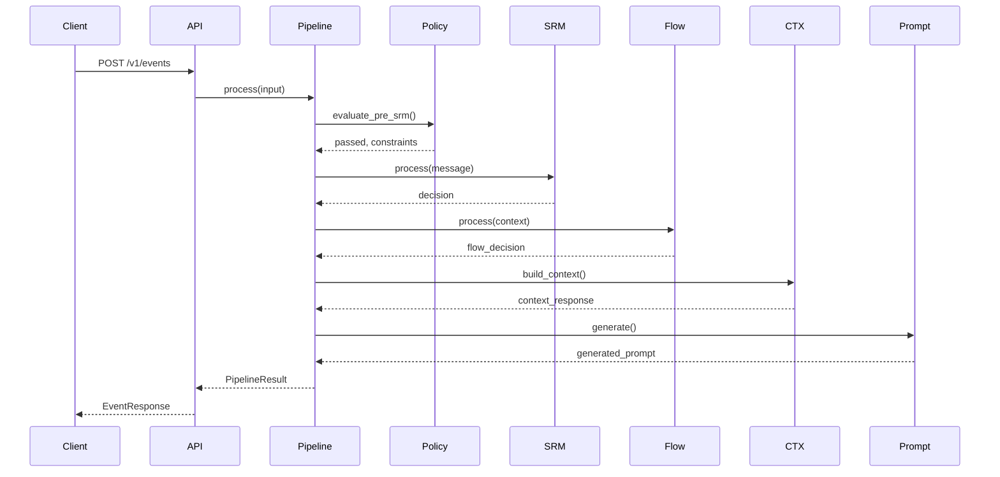
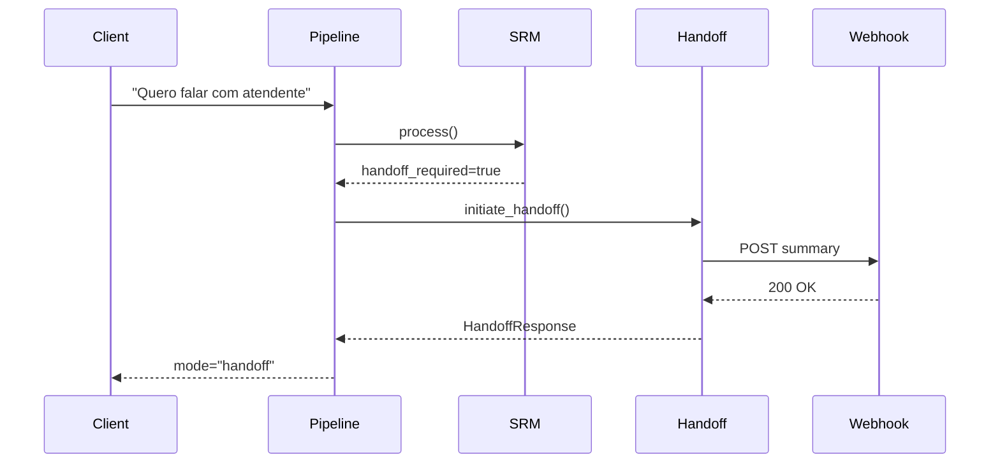
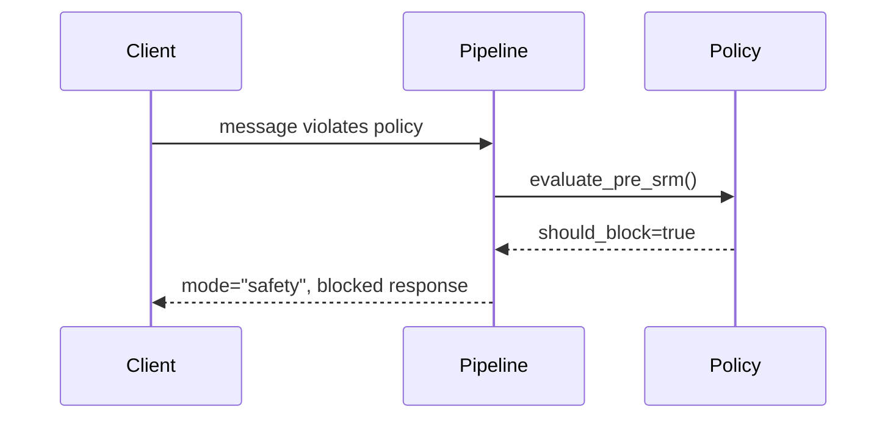

# NeuroStack - Cognitive Pipeline Documentation

**Versão:** 0.3.0  
**Data:** Fevereiro 2026  
**Alinhamento:** Documentação Técnica MVP v0.5 (funil 11 etapas, intenções oficiais, ClinicConfig, UserState)

---

## Índice

1. [Visão Geral](#visão-geral)
2. [Arquitetura do Pipeline](#arquitetura-do-pipeline)
3. [Estágios do Pipeline](#estágios-do-pipeline)
4. [Modos de Fluxo](#modos-de-fluxo)
5. [Fluxos de Processamento](#fluxos-de-processamento)
6. [Exemplos de Uso](#exemplos-de-uso)
7. [Métricas e Observabilidade](#métricas-e-observabilidade)

---

## Visão Geral

O **Cognitive Pipeline** é o orquestrador central do NeuroStack que conecta todos os módulos cognitivos em um fluxo de processamento end-to-end. Ele recebe eventos (mensagens de usuário) e retorna decisões cognitivas completas com prompts prontos para LLM.

### Componentes Integrados

```
┌─────────────────────────────────────────────────────────────────────┐
│                        COGNITIVE PIPELINE                           │
├─────────────────────────────────────────────────────────────────────┤
│                                                                     │
│  ┌──────────┐  ┌──────┐  ┌──────┐  ┌─────┐  ┌────────┐  ┌────────┐ │
│  │  Policy  │→ │ SRM  │→ │ Flow │→ │ CTX │→ │ Prompt │→ │Handoff │ │
│  │  Engine  │  │Engine│  │ Mgr  │  │     │  │ Engine │  │Service │ │
│  └──────────┘  └──────┘  └──────┘  └─────┘  └────────┘  └────────┘ │
│                                                                     │
│  Pre-Check    Decision  Mode     Context   Prompt      (Opcional)  │
│               Making    Control  Assembly  Generation              │
│                                                                     │
└─────────────────────────────────────────────────────────────────────┘
```

---

## Arquitetura do Pipeline

### Entrada (PipelineInput)

```python
class PipelineInput:
    tenant_id: UUID           # Identificador do tenant (clínica/builder)
    session_id: UUID          # Identificador da sessão de conversa
    message: str              # Mensagem do usuário
    channel: str              # Canal (whatsapp, web, telegram, etc.)
    user_id: str | None       # ID do usuário no sistema do builder
    
    # Contexto da sessão (do StateStore)
    current_funnel_stage: str      # lead_novo, em_qualificacao, ... (11 etapas)
    turn_count: int
    intent_history: list[str]
    slots: dict[str, Any]
    flags: dict[str, bool]
    message_history: list[dict]
    clinic_config: dict | None     # Doc MVP v0.5 (quando carregado)
    user_state: dict | None        # Doc MVP v0.5 (quando carregado)
```

### Saída (PipelineResult)

```python
class PipelineResult:
    # Identificadores
    event_id: UUID
    tenant_id: UUID
    session_id: UUID
    
    # Decisão SRM (intenções oficiais 23 + catálogo de ações)
    intent: str                    # saudacao, pedido_preco, agendar, conduta_inadequada_ameaca, etc.
    intent_category: str           # scheduling, question, complaint, etc.
    funnel_stage: str              # lead_novo, em_qualificacao, ... (11 etapas)
    funnel_stage_before: str | None # Estágio antes da transição (Decision Trace)
    action: str                    # iniciar_fluxo_qualificacao_srm, handoff_administrativo, etc.
    confidence: float              # Score de confiança (0-1)
    safety_concern: bool           # Se há preocupação de segurança
    safety_category: str           # clinical_risk, legal_risk, etc.
    needs_rag: bool                # Se precisa consultar conhecimento
    handoff_required: bool         # Se requer transferência humana
    handoff_reason: str | None     # Motivo do handoff
    reasoning: str | None          # Explicação da decisão
    
    # Atualizações de Estado
    state_patch: dict              # Mudanças a aplicar na sessão
    
    # Prompt para LLM
    system_prompt: str             # System prompt
    instructions: str              # Instruções específicas
    constraints: list[str]         # Restrições a seguir
    context_summary: str | None    # Resumo do contexto
    
    # Contexto
    recent_messages: list[dict]    # Mensagens recentes formatadas
    rag_sources: list[dict]        # Fontes de conhecimento (quando RAG)
    turn_count: int                # Contagem de turnos atualizada
    
    # Modo e Handoff
    mode: str                      # normal, rag, safety, handoff
    handoff_summary: dict | None   # Resumo para agente humano
    handoff_user_message: str      # Mensagem para o usuário
    
    # Metadados
    processed_at: str              # Timestamp de processamento
    processing_time_ms: int        # Tempo de processamento
    stage_timings: dict[str, float] # Tempo por estágio
```

### Contexto da interação (`ResolvedInteractionContext`)

A borda de entrada (rota `/v1/events` ou adaptador de webhook) constrói uma
única vez um `ResolvedInteractionContext` (`src/interaction_context.py`) com
tenant efetivo, sessão, `origin` e `interaction_event_id`. A origem vem só da
credencial: API key e Z-API/Meta → `production`; JWT operacional →
`simulator`; Evolution/Uazapi e chamadores sem prova → `unknown`. `channel` é
transporte e não influencia. No pipeline, o contexto só é consumido depois que
o lock da sessão (`_lock_session_state`) prova a sessão no tenant; a exceção é
a captura de mensagem com a sessão pausada no webhook, que grava o `message.in`
após uma busca da sessão filtrada por tenant, sem esse lock.
`interaction_event_id` é reservado apenas para `message.in` e só é exposto se
o Event Store gravou o evento. Todos os eventos da interação persistem a mesma
`interaction_origin`.

---

## Estágios do Pipeline

### 1. Policy Pre-Check (Policy Engine)

**Propósito:** Validar a mensagem contra políticas antes de processamento.

**Responsabilidades:**
- Verificar regras globais de segurança
- Aplicar políticas específicas do tenant
- Decidir se a mensagem deve ser bloqueada
- Gerar lista de constraints para o prompt

**Resultado:**
- `passed`: Mensagem pode ser processada
- `blocked`: Mensagem viola políticas (retorna resposta de bloqueio)
- `constraints`: Lista de restrições para o LLM

### 2. SRM Processing (Small Reasoning Module)

**Propósito:** Decisão cognitiva determinística sobre a mensagem.

**Responsabilidades:**
- Classificar intent (o que o usuário quer)
- Detectar estágio do funil
- Avaliar preocupações de segurança
- Decidir necessidade de RAG
- Decidir necessidade de handoff
- Gerar patch de estado

**Subcomponentes:**
- `IntentClassifier`: Classifica intenção e categoria
- `FunnelDetector`: Detecta transições de estágio
- `SafetyDetector`: Avalia riscos clínicos/legais
- `HandoffDecider`: Decide transferência para humano
- `RagDecider`: Decide consulta de conhecimento

### 3. Flow Management (Flow Manager)

**Propósito:** Gerenciar máquina de estados do fluxo de conversa.

**Responsabilidades:**
- Determinar modo atual (NORMAL, RAG, SAFETY, HANDOFF)
- Gerenciar transições entre modos
- Aplicar handlers específicos por modo
- Registrar transições no Event Store

**Modos:**
- `NORMAL`: Fluxo conversacional padrão
- `RAG`: Consulta de conhecimento ativa
- `SAFETY`: Modo de segurança ativo
- `HANDOFF`: Preparação para transferência

### 4. Context Building (CTX Orchestrator)

**Propósito:** Montar contexto completo para geração de prompt.

**Responsabilidades:**
- Incluir estado cognitivo da sessão
- Filtrar histórico por relevância
- Comprimir histórico longo
- Buscar conhecimento (quando RAG)
- Aplicar constraints de políticas

**Componentes:**
- `ContextBuilder`: Monta a estrutura de contexto
- `RelevanceFilter`: Filtra mensagens relevantes
- `HistoryCompressor`: Comprime histórico longo
- `KnowledgeService`: Busca conhecimento (RAG)

### 5. Prompt Generation (Prompt Engine)

**Propósito:** Gerar prompt estruturado para LLM.

**Responsabilidades:**
- Selecionar template apropriado por modo
- Renderizar template com variáveis
- Incluir histórico de conversa
- Incluir constraints e instruções

**Templates:**
- `NormalTemplate`: Fluxo padrão
- `SafetyTemplate`: Modo de segurança
- `HandoffTemplate`: Preparação para handoff
- (RAG usa NormalTemplate com conhecimento)

### 6. Handoff Service (Opcional)

**Propósito:** Iniciar transferência para agente humano.

**Executado quando:** `srm_decision.handoff_required == True`

**Responsabilidades:**
- Gerar resumo estruturado da conversa
- Extrair informações-chave (slots)
- Enviar webhook para sistema externo
- Registrar evento no Event Store (`handoff.request` herda a `interaction_origin` do contexto, sem `interaction_event_id`; eventos tardios accept/complete/timeout são `unknown`)
- Retornar mensagem para o usuário

---

## Modos de Fluxo

### NORMAL Mode

```
Usuário: "Olá, gostaria de agendar uma consulta"

Pipeline:
  Policy: ✓ Passed (sem violações)
  SRM: intent=agendar ou interesse_tratamento, confidence=0.92
  Flow: mode=NORMAL
  CTX: histórico recente, ClinicConfig/UserState quando disponíveis
  Prompt: template normal com instruções de agendamento
  
Result:
  mode: "normal"
  intent: "agendar" | "interesse_tratamento"
  action: "iniciar_fluxo_qualificacao_srm" | "coletar_preferencias_agendamento"
  funnel_stage: "lead_novo" | "em_qualificacao"
  prompt: "Pergunte horário preferido..."
```

### RAG Mode

```
Usuário: "Quais especialidades a clínica oferece?"

Pipeline:
  Policy: ✓ Passed
  SRM: intent=question_general, needs_rag=true
  Flow: mode=RAG
  CTX: busca conhecimento sobre especialidades
  Prompt: template normal + conhecimento injetado
  
Result:
  mode: "rag"
  needs_rag: true
  rag_sources: [{title: "Especialidades", content: "..."}]
```

### SAFETY Mode

```
Usuário: "Qual remédio devo tomar para dor de cabeça?"

Pipeline:
  Policy: ✓ Passed (com constraints de segurança)
  SRM: intent=question_medical, safety_concern=true
  Flow: mode=SAFETY
  CTX: contexto + lembretes de segurança
  Prompt: template safety com restrições
  
Result:
  mode: "safety"
  safety_concern: true
  safety_category: "clinical_risk"
  constraints: ["Não fornecer diagnósticos", "Não recomendar medicamentos"]
```

### HANDOFF Mode

```
Usuário: "Quero falar com um atendente humano"

Pipeline:
  Policy: ✓ Passed
  SRM: intent=saudacao + padrão explícito de handoff → handoff_required=true
  Flow: mode=HANDOFF
  CTX: contexto para resumo
  Prompt: template handoff
  Handoff: setor=administrativo, sla=prioritario; gera resumo, envia webhook
  
Result:
  mode: "handoff"
  handoff_required: true
  handoff_reason: "user_request"
  handoff_sector: "administrativo"
  handoff_sla: "prioritario"
  handoff_summary: {summary: "...", sector, sla, key_info: {...}}
  handoff_user_message: "Estou transferindo você..."
```

---

## Fluxos de Processamento

### Fluxo Normal (Sucesso)



### Fluxo com Handoff



### Fluxo com Policy Block



---

## Exemplos de Uso

### Python - Uso Direto do Pipeline

```python
from uuid import uuid4
from src.core.pipeline import process_event

result = await process_event(
    tenant_id=uuid4(),
    session_id=uuid4(),
    message="Olá, gostaria de agendar uma consulta",
    channel="whatsapp",
    user_id="user-123",
    current_funnel_stage="lead_novo",
    turn_count=0,
)

print(f"Intent: {result.intent}")
print(f"Mode: {result.mode}")
print(f"Prompt: {result.system_prompt}")
print(f"Time: {result.processing_time_ms}ms")
```

### Python - Via API

```python
import requests

response = requests.post(
    "http://localhost:8000/v1/events",
    headers={"X-API-Key": "your-api-key"},
    json={
        "tenant_id": "a1b2c3d4-...",
        "session_id": "b2c3d4e5-...",
        "event_type": "message.in",
        "payload": {
            "content": "Olá!",
            "channel": "whatsapp",
        },
    },
)

data = response.json()
print(f"Mode: {data['mode']}")
print(f"Decision: {data['decision']}")
print(f"Prompt: {data['prompt']}")
```

---

## Métricas e Observabilidade

### Métricas Prometheus

```
# Total de execuções do pipeline
neurostack_pipeline_total{mode, result}

# Latência do pipeline
neurostack_pipeline_latency_seconds

# Latência por estágio
neurostack_pipeline_stage_latency_seconds{stage}
  - stage: policy, srm, flow, ctx, prompt, handoff
```

### Stage Timings

Cada resultado inclui tempos por estágio para debugging:

```python
result.stage_timings = {
    "policy": 2.5,    # ms
    "srm": 8.3,       # ms
    "flow": 1.2,      # ms
    "ctx": 15.7,      # ms
    "prompt": 3.1,    # ms
    "handoff": 45.2,  # ms (quando aplicável)
}
```

### Logging

O pipeline registra logs estruturados em cada estágio:

```json
{
  "event": "Processing pipeline",
  "tenant_id": "a1b2c3d4-...",
  "session_id": "b2c3d4e5-...",
  "channel": "whatsapp"
}

{
  "event": "Pipeline complete",
  "event_id": "c3d4e5f6-...",
  "mode": "normal",
  "intent": "scheduling_request",
  "processing_time_ms": 35
}
```

---

## Troubleshooting

### Problema: Latência Alta

1. Verifique `stage_timings` para identificar estágio lento
2. Estágios comuns de gargalo:
   - `ctx`: Histórico muito longo
   - `handoff`: Webhook lento
   - `policy`: Muitas regras

### Problema: Intent Incorreto

1. Verifique padrões do IntentClassifier
2. Adicione keywords no tenant
3. Verifique confidence threshold

### Problema: Handoff Não Dispara

1. Verifique configuração do HandoffDecider
2. Verifique keywords de handoff
3. Verifique limite de turns

---

---

## Referências

- **Documentação Técnica NeuroStack (MVP v0.5):** funil 11 etapas, 23 intenções oficiais, catálogo de ações, ClinicConfig, UserState/FunnelState, handoff por setor/SLA, políticas C_* e POL_*.
- [Contratos de API](./api-contracts.md) – eventos CRM (`ns.funnel_stage_changed`, `ns.handoff_created`), Decision Trace, handoff sector/SLA.

*Documentação do Cognitive Pipeline - NeuroStack v0.3.0*

